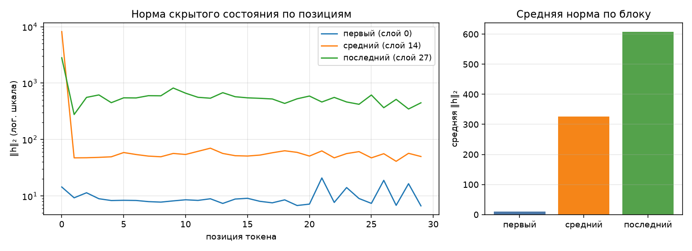

# Анатомия Qwen3-0.6B

Сгенерировано `make inspect`. dtype `bfloat16`, device `cpu`.

## 1. Конфигурация

| Параметр | Значение |
|---|--:|
| слоёв | 28 |
| hidden_size | 1024 |
| intermediate_size | 3072 |
| голов запроса | 16 |
| KV-голов (GQA) | 8 |
| head_dim | 128 |
| словарь | 151 936 |
| tie_word_embeddings | True |

GQA: 16 голов запроса на 8 KV-головы — KV-cache вдвое меньше, чем при обычном multi-head.

## 2. Условия замера

| Условие | Значение |
|---|---|
| платформа | Windows-11-10.0.26200-SP0 (Windows 11, AMD64) |
| устройство | `cpu` |
| dtype | `bfloat16` |
| seq_len × batch | 256 × 1 |
| прогонов на режим | 1 |
| память измерена | `peak_wset` |
| RSS измерена | `peak_wset` |
| python | 3.13.0 |
| torch | 2.14.0+cpu |
| transformers | 5.17.0 |
| peft | 0.20.0 |

Цифры ниже верны только для этих условий. Замер памяти без указания
устройства, dtype, длины последовательности и метрики не воспроизводится
и не сравнивается — поэтому источник метрики стоит отдельной строкой.
Сверьте, что в этой строке названа метрика, уместная для вашего
устройства, и что полученные числа с ней согласуются.

## 3. Параметры по типам модулей

| Группа | Модулей | Shape | Параметров | Доля | Разделяет тензор |
|---|--:|---|--:|--:|--:|
| `embed` | 1 | 151936×1024 | 155 582 464 | 26.10% | — |
| `q_proj` | 28 | 2048×1024 | 58 720 256 | 9.85% | — |
| `k_proj` | 28 | 1024×1024 | 29 360 128 | 4.93% | — |
| `v_proj` | 28 | 1024×1024 | 29 360 128 | 4.93% | — |
| `o_proj` | 28 | 1024×2048 | 58 720 256 | 9.85% | — |
| `gate_proj` | 28 | 3072×1024 | 88 080 384 | 14.78% | — |
| `up_proj` | 28 | 3072×1024 | 88 080 384 | 14.78% | — |
| `down_proj` | 28 | 1024×3072 | 88 080 384 | 14.78% | — |
| `norm` | 113 | 128, 1024 | 65 536 | 0.01% | — |
| `lm_head` | 1 | 151936×1024 | 0 | 0.00% | 155 582 464 |
| **итого** | | | **596 049 920** | 100% | |

Контроль: `sum(p.numel() for p in model.parameters())` = 596 049 920 — сходится с суммой по таблице.

Обратите внимание на строку `lm_head` и на значение `tie_word_embeddings`
в конфигурации: они связаны, и от этой связи зависит итог таблицы.

## 4. Нормы активаций (forward-hooks)

Промпт: «Объясни, что такое MLOps, в трёх предложениях.», 30 токенов после chat template.

| Блок | Индекс | Средняя ‖h‖₂ | Максимум |
|---|--:|--:|--:|
| первый | 0 | 9.7 | 20.9 |
| средний | 14 | 325.5 | 8189.7 |
| последний | 27 | 607.1 | 2815.4 |

Норма растёт от блока к блоку — прямое следствие residual-связей: блок
добавляет к потоку, а не заменяет его. Максимум на порядок-два выше среднего,
и сидит он на первой позиции: это attention sink, массивная активация,
в которую модель складывает «внимание ни к чему». Поэтому шкала на графике
логарифмическая — в линейной один этот выброс придавил бы всё остальное.

Прогон с хуками должен быть повторяемым: второй вызов в том же процессе
обязан дать те же числа и не оставить следов на модулях.

## 5. Сколько параметров добавляет LoRA

| Конфиг | Целевых модулей | Своя формула | peft | Совпало | % от базовой |
|---|--:|--:|--:|:-:|--:|
| r=8, q_proj+v_proj | 2 типов | 1 146 880 | 1 146 880 | да | 0.192% |
| r=16, все линейные | 7 типов | 10 092 544 | 10 092 544 | да | 1.693% |

Формула: `r * (in_features + out_features)` на каждый целевой `Linear` —
`A` формы `(r, in)`, `B` формы `(out, r)`, смещений нет. Расхождение с
`print_trainable_parameters()` означает ошибку в списке целевых модулей,
а не «разные способы считать».

Доля в таблице считается от базовой модели. `peft` печатает свою долю от
модели ВМЕСТЕ с адаптером, поэтому его процент чуть меньше — числитель
у обоих один и тот же.

## 6. Память в трёх режимах

Один шаг на seq_len=256, batch=1, device=cpu. Метрика — RSS процесса (`peak_wset`), пик за прогон; колонка «Пик RSS» снята через `peak_wset`.
Вход — случайные id токенов: меряется память, а не качество, и loss здесь
смысловой нагрузки не несёт (у full FT и LoRA он одинаковый, потому что
`B` в адаптере инициализирован нулями и до первого шага ничего не меняет).
Числа должны отличаться: по лекции full fine-tune стоит кратно дороже
инференса, а LoRA лежит между ними.

| Режим | Пик, МБ | Пик RSS, МБ | × к инференсу | Секунд | loss |
|---|--:|--:|--:|--:|--:|
| инференс | 1856 | 1856 | 1.00 | 8.5 | — |
| full fine-tune | 5806 | 5806 | 3.13 | 795.6 | 13.9603 |
| LoRA (r=8, q/v) | 2540 | 2540 | 1.37 | 769.4 | 13.9603 |

Прикидка из лекции: веса bf16 — 1137 МБ. Full fine-tune добавляет
градиенты (+1137 МБ) и два состояния AdamW (+2274 МБ),
то есть ×4 к весам ещё до активаций — что и видно в замере.
LoRA обучает 1 146 880 параметров вместо 596 049 920:
градиенты и состояния оптимизатора считаются только для адаптера, базовые
веса заморожены. Остаётся расход на активации — поэтому LoRA всё же дороже
инференса, хоть и втрое дешевле полного дообучения.

Устройство — `cpu`, поэтому основная метрика и есть RSS процесса (`peak_wset`), обе колонки совпадают.
На mps и cuda они разошлись бы: там тензоры лежат в памяти ускорителя
и в RSS почти не видны, а разница между режимами исчезает.

## 7. Разбор найденных дефектов

### Дефект 1 — хуки навешаны, но не сняты

**В чём был:** `forward_hooks()` регистрировал `register_forward_hook` на
каждый модуль, но возвращал только словарь `store`, куда хуки пишут —
объекты-хендлы (`RemovableHandle`), которые нужны для `handle.remove()`,
нигде не сохранялись. Снять хуки было физически нечем.

**Как проявлялся:** повторный вызов `activation_norms()` в одном процессе
навешивал ещё один комплект хуков поверх старого — на модулях копились
дубликаты, активации считались бы несколько раз, а `len(module._forward_hooks)`
рос с каждым прогоном вместо того, чтобы возвращаться к нулю.

**Как исправлен:** `forward_hooks()` теперь возвращает ещё и список хендлов;
`activation_norms()` снимает их в `finally` после прогона — даже если forward
упадёт с исключением, хуки не останутся висеть. Проверено тестом 3 из
`check.sh`, который два раза подряд в одном процессе гоняет
`activation_norms()` и требует `len(module._forward_hooks) == 0` после
каждого прогона — оба раза ноль.

### Дефект 2 — tied embeddings считаются дважды

**В чём был:** `parameter_rows()` вызывал `named_parameters(remove_duplicate=False)`
(правильно — иначе `lm_head` вообще выпал бы из обхода), но жёстко писал
`"tied": False` для каждой строки вместо того, чтобы отличить повторный
проход по уже виденному тензору.

**Как проявлялся:** `embed_tokens` и `lm_head` — один и тот же тензор
(`tie_word_embeddings=True` у Qwen3), но оба считались как отдельные вклады
в сумму. Итог получался на четверть больше настоящего: сумма по таблице не
сходилась с `sum(p.numel() for p in model.parameters())`.

**Как исправлен:** `parameter_rows()` ведёт множество `id()` уже увиденных
тензоров; повторное появление того же объекта помечается `tied=True` и не
идёт в сумму `params`, а идёт в `tied_params`. В получившемся отчёте
`lm_head` весит 0 параметров, `tied_params=155 582 464`, а `embed` несёт на
себе весь вес эмбеддинга — `params_total = params_direct = 596 049 920`,
сходится ровно (раздел 3 выше, тест 1 из `check.sh`).

### Дефект 3 — три режима памяти мерялись в одном процессе (и TODO про gc.collect())

**В чём был:** `memory_profile()` вызывал `measure_mode()` напрямую в цикле
по трём режимам внутри одного процесса, хотя в CLI специально заведён флаг
`--probe MODE` именно для запуска в отдельном процессе. Пиковые метрики —
`ru_maxrss`/`peak_wset`/`cuda.max_memory_allocated` — high-water mark за
жизнь процесса и никогда не уменьшаются; измерив три режима подряд в одном
процессе, получаешь три раза максимум самого тяжёлого из них. Отдельно
`PeakMemory.__exit__` вызывал `gc.collect()` перед самим снятием метрики —
TODO в коде прямо спрашивал, что мы на самом деле меряем: расход режима или
то, что осталось после уборки мусора.

**Как проявлялся:** без изоляции `full_ft`, идущий последним в списке
`MODES` после уже посчитанных `inference`, унаследовал бы взвинченный
`inference`-режимом high-water mark, и три числа выглядели бы почти
одинаковыми — именно симптом из README.

**Как исправлен:** `memory_profile()` теперь запускает каждый повтор
каждого режима отдельным процессом — `measure_mode_isolated()` вызывает
`python -m src.inspect_model --probe <mode>` через `subprocess.run` и
парсит JSON из stdout. Каждый процесс стартует с чистым счётчиком пиковой
памяти. `gc.collect()` перед снятием метрики убран: для `ru_maxrss`/
`peak_wset`/`cuda.max_memory_allocated` порядок неважен (это уже
исторический максимум, gc его не уменьшит), а для
`mps.driver_allocated_memory` — это снимок текущего состояния, и
`gc.collect()` перед снятием попросту занизил бы пик, освободив буферы
раньше времени. Результат — раздел 6 выше: `inference` 1856 МБ, `LoRA`
2540 МБ, `full_ft` 5806 МБ, порядок и кратность ровно как в лекции; тест 4
из `check.sh` требует `full_ft > lora > inference` и проходит.

### Дефект 4 — на ускорителе память мерялась через RSS

**В чём был:** `device_allocated_bytes()` и `device_metric_source()`
игнорировали переданный `device` и безусловно делегировали в `peak_rss()` —
то есть даже на `cuda`/`mps` память бы мерилась через RSS процесса.

**Как проявлялся:** на ускорителе тензоры лежат в памяти самого ускорителя
и почти не отражаются в RSS процесса — три режима давали бы похожие числа
на видеокарте так же, как на CPU без изоляции процессов, а «память модели»
могла оказаться меньше веса её же параметров.

**Как исправлен:** обе функции теперь смотрят на `device.type`: `cuda` →
`torch.cuda.max_memory_allocated()`, `mps` → `torch.mps.driver_allocated_memory()`,
иначе (`cpu`) — прежний RSS (`ru_maxrss`/`peak_wset`). На этой машине
`device=cpu`, поэтому в замере выше видна ветка RSS; правильность ветки
ускорителя проверяется тестом 6 из `check.sh` — он явно запрещает
`ru_maxrss`/`peak_wset` как источник, если `device` начинается с `mps`/`cuda`.

### Дополнительно: `uv.lock` был в `.gitignore`

Не входит в 4 заявленных дефекта, но README прямо требует закоммитить
`uv.lock` («без него окружение не воспроизводится»), а `.gitignore`
исключал именно его. Исправлено — `uv.lock` убран из игнора, вместо него
добавлен `.DS_Store` (мусор от распаковки на Mac).
